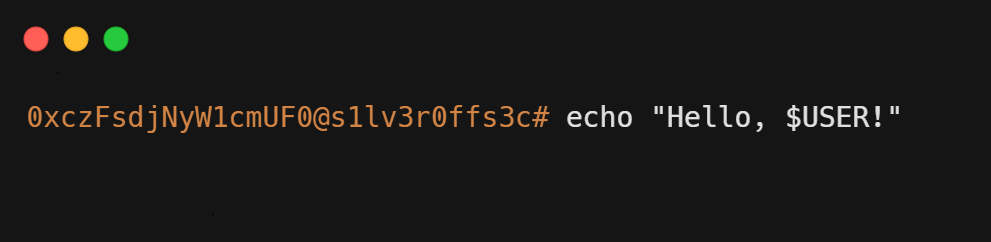

# s1lv3r0ffs3c

Боевой оффсек-блокнот. Вернулся, чтобы сделать красиво.

Это моя личная записная книжка для всего, что связано с оффсеком: рабочие материалы, утилиты, пейлоады, отчёты и всё, что может оказаться полезным.
Не для понтов, а для практического применения. Если это кому то окажется полезным — отлично, если нет — тоже не беда.

### Структура репозитория:
- **CTF**: Сезоны ACLabs, разборы тасков и каталог публичных writeups. Просто на память о том, как закалялась сталь.
- **Certs**: Дипломы, сертификаты, завершенные курсы. Исключительно по теме, ничего лишнего.
- **Stuff**: Полезные материалы, скрипты и пейлоады, ссылки на ресурсы. Всегда под рукой.
- **WriteUps**: Краткие отчёты по задачам и уязвимостям, просто чтобы не забыть.
- **[_templates](_templates/writeup.md)**: Шаблоны заметок, чтобы writeup'ы выходили в одном формате.

### Карта заметок

**Stuff** — [reverse-shells](./Stuff/reverse-shells.md) · [sqli](./Stuff/sqli.md) · [ssti](./Stuff/ssti.md) · [file-upload](./Stuff/file-upload.md) · [web-checklist](./Stuff/web-checklist.md) · [resources](./Stuff/resources.md) · [скрипты](./Stuff/scripts/)

**WriteUps / THM** — [0day](./WriteUps/THM/0day.md) · [ad-cert-templates](./WriteUps/THM/ad-cert-templates.md) · [attacktive-directory](./WriteUps/THM/attacktive-directory.md) · [breaking-rsa](./WriteUps/THM/breaking-rsa.md) · [cactus](./WriteUps/THM/cactus.md) · [fat32-analysis](./WriteUps/THM/fat32-analysis.md) · [http2-request-smuggling](./WriteUps/THM/http2-request-smuggling.md) · [insecure-deserialisation](./WriteUps/THM/insecure-deserialisation.md) · [localpotato](./WriteUps/THM/localpotato.md) · [macos-forensics-artefacts](./WriteUps/THM/macos-forensics-artefacts.md) · [management-wants-a-word](./WriteUps/THM/management-wants-a-word.md) · [noscope-rce](./WriteUps/THM/noscope-rce.md) · [olympus](./WriteUps/THM/olympus.md) · [printnightmare](./WriteUps/THM/printnightmare.md) · [python-playground](./WriteUps/THM/python-playground.md) · [relevant](./WriteUps/THM/relevant.md) · [ret2libc](./WriteUps/THM/ret2libc.md) · [squid-game](./WriteUps/THM/squid-game.md) · [the-hollow-shell](./WriteUps/THM/the-hollow-shell.md) · [w1seguy](./WriteUps/THM/w1seguy.md)

**WriteUps / PortSwigger** — [2fa-bruteforce-macro](./WriteUps/PortSwigger/labs/2fa-bruteforce-macro.md) · [file-upload-race-condition](./WriteUps/PortSwigger/labs/file-upload-race-condition.md) · [file-upload-rce](./WriteUps/PortSwigger/labs/file-upload-rce.md) · [partial-construction-race](./WriteUps/PortSwigger/labs/partial-construction-race.md) · [sqli-hidden-data](./WriteUps/PortSwigger/labs/sqli-hidden-data.md) · [sqli-login-bypass](./WriteUps/PortSwigger/labs/sqli-login-bypass.md) · [ssrf-blind-shellshock](./WriteUps/PortSwigger/labs/ssrf-blind-shellshock.md) · [ssrf-whitelist-bypass](./WriteUps/PortSwigger/labs/ssrf-whitelist-bypass.md)

**Certs** — [всё обучение](./Certs/education.md) · [комнаты THM](./Certs/TryHackMe/rooms.md) · [roadmap](./Certs/roadmap.md) · **CTF** — [сезоны ACLabs](./CTF/README.md) · [таски](./CTF/tasks/) · [readings](./CTF/readings.md)

Минимум слов, максимум полезного контента. Хочешь обсудить или поделиться идеями — открой issue!

**Примечание**: Эта страница активно обновляется. Буду рад сотрудничеству и обмену опытом.
