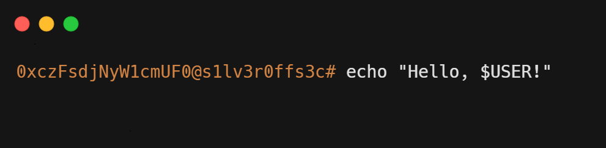

# s1lv3r0ffs3c

Боевой оффсек-блокнот. Всё, что реально выручало в лабах и CTF — без воды и «awesome-списков».

## Что внутри

| Раздел | Что там |
|---|---|
| [`Stuff/`](./Stuff) | Шпаргалки и боевые скрипты: реверс-шеллы, SQLi, SSTI, загрузка файлов, веб-чеклист + `scripts/` (генераторы шеллов, энумерация Linux/Windows, AD-цепочка, веб-шеллы) |
| [`WriteUps/`](./WriteUps) | Разборы: 12 машин TryHackMe (все hard) и 8 лаб PortSwigger (включая все 5 пройденных expert), прогресс по академии |
| [`Certs/`](./Certs) | Дипломы и сертификаты за 3 года, дамп профиля TryHackMe (329 комнат, топ 1%), сводка обучения |
| [`CTF/`](./CTF) | Участие в сезонных CTF ACLabs: 6 сезонов подряд, топ-10 в трёх, победа в S3 |

## Статус сейчас

- **TryHackMe:** уровень 14, 329 комнат (218 easy / 80 medium / 6 hard), ранг top 1%
- **PortSwigger Academy:** Apprentice 61/61, Practitioner 63/173, Expert 5/39; к BSCP остались mystery labs и practice exam
- **ACLabs CTF:** 1-е место S3, 5-е S4, 8-е S7

## Зачем

Минимум слов, максимум полезного. Если кому-то окажется полезным — отлично. Хочешь обсудить или поделиться идеями — открывай issue.
