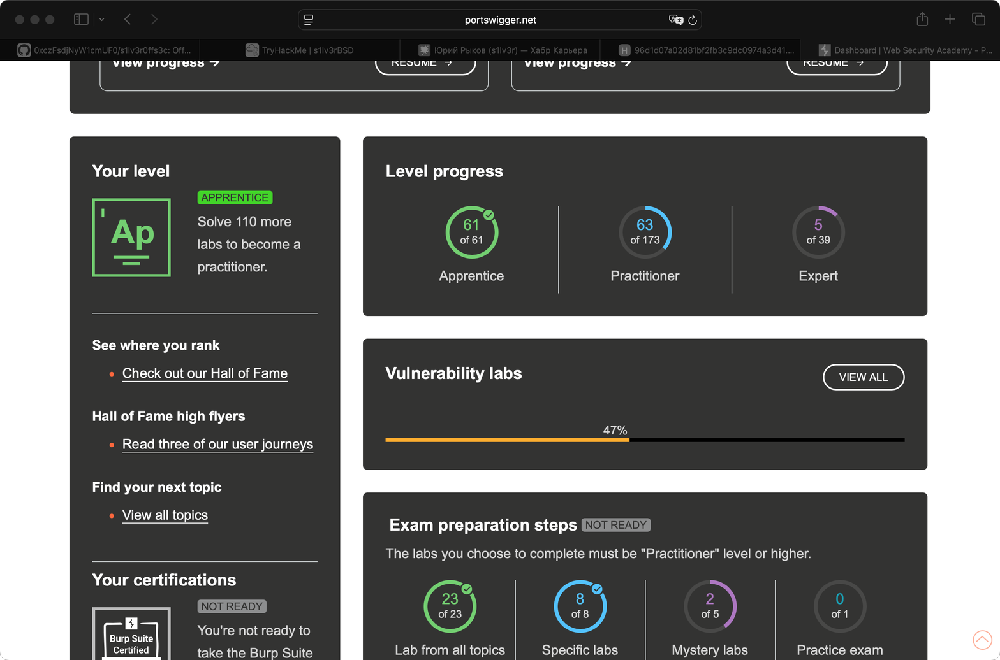
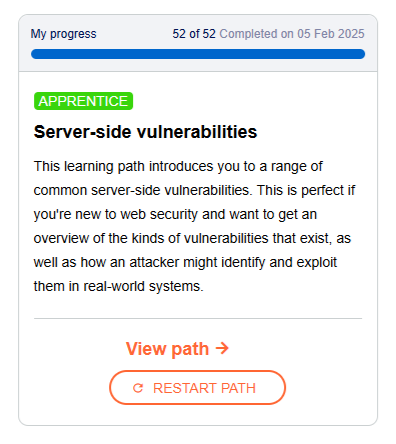
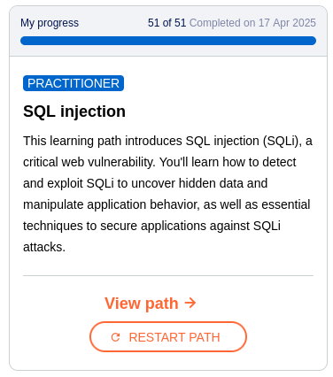
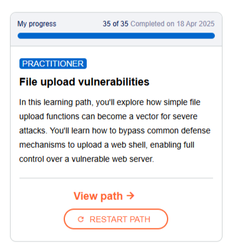
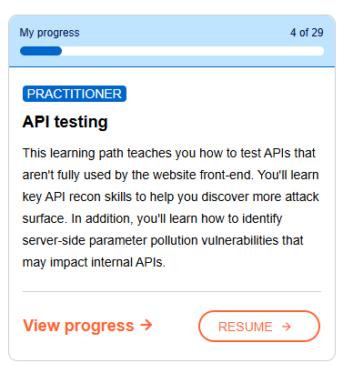
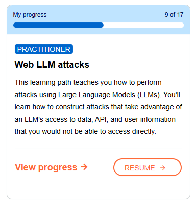

# PortSwigger Web Security Academy

---

## Общий прогресс

Обновлено 2026-11-05 по актуальному списку всех лабораторных работ (273 шт., сверено с дашбордом): 

| Показатель              | Значение                        |
|-------------------------|------------------------------|
| Текущий уровень         | APPRENTICE (до Practitioner ещё 110 лабораторных) |
| Решено (Apprentice)  | 61 / 61 — закрыт полностью   |
| Решено (Practitioner) | 63 / 173                     |
| Решено (Expert) | 5 / 39                       |
| Прогресс лабораторных      | 47%                          |

---

## Подготовка к сертификации

К экзамену пока не готов: по моему плану остались Mystery labs и пробный экзамен.

Список подготовки (лабораторные уровня Practitioner и выше):

| Пункт                    | Прогресс       |
|--------------------------|----------------|
| Лабораторные по всем темам     | 23 / 23 — выполнено |
| Выбранные лабораторные            | 8 / 8 — выполнено   |
| Mystery labs             | 2 / 5          |
| Practice exam            | 0 / 1          |

---

## Прогресс по темам

A = Apprentice, P = Practitioner, E = Expert. Формат «решено/всего».

| Тема | A | P | E |
|------|---|---|---|
| API testing | 1/1 | 0/3 | 0/1 |
| Access control vulnerabilities | 9/9 | 1/4 | 0/0 |
| Authentication | 3/3 | 6/9 | **1/2** ✅ |
| Business logic vulnerabilities | 4/4 | 2/7 | 0/1 |
| Clickjacking | 3/3 | 1/2 | 0/0 |
| Cross-origin resource sharing (CORS) | 2/2 | 1/1 | 0/0 |
| Cross-site request forgery (CSRF) | 1/1 | 1/10 | 0/0 |
| Cross-site scripting | 9/9 | 2/16 | 0/5 |
| DOM-based vulnerabilities | 0/0 | 1/5 | 0/2 |
| File upload vulnerabilities | 2/2 | 4/4 | **1/1** ✅ |
| GraphQL API vulnerabilities | 1/1 | 0/4 | 0/0 |
| HTTP Host header attacks | 2/2 | 1/4 | 0/1 |
| HTTP request smuggling | 0/0 | 2/15 | 0/7 |
| Information disclosure | 4/4 | 1/1 | 0/0 |
| Insecure deserialization | 1/1 | 3/6 | 0/3 |
| JWT | 2/2 | 2/4 | 0/2 |
| NoSQL injection | 2/2 | 0/2 | 0/0 |
| OAuth authentication | 1/1 | 2/4 | 0/1 |
| OS command injection | 1/1 | 1/4 | 0/0 |
| Path traversal | 1/1 | 5/5 | 0/0 |
| Prototype pollution | 0/0 | 0/9 | 0/1 |
| Race conditions | 1/1 | 3/4 | **1/1** ✅ |
| SQL injection | 2/2 | 16/16 | 0/0 |
| Server-side request forgery (SSRF) | 2/2 | 2/3 | **2/2** ✅ |
| Server-side template injection | 0/0 | 1/5 | 0/2 |
| Web LLM attacks | 3/3 | 1/4 | 0/1 |
| Web cache deception | 1/1 | 0/3 | 0/1 |
| Web cache poisoning | 0/0 | 1/9 | 0/4 |
| WebSockets | 1/1 | 1/2 | 0/0 |
| XML external entity (XXE) injection | 2/2 | 1/6 | 0/1 |
| Essential skills (learning path) | — | 1/2 | — |

По таблице выше полностью пройдены SQL injection, Path traversal, File upload, CORS и Information disclosure. В Access control, Race conditions и SSRF ещё остались лабораторные уровня Practitioner.

---

## Разборы лабораторных уровня Expert

Все 5 пройденных экспертных лаб разобраны в [`labs/`](./labs/):

- [Blind SSRF with Shellshock exploitation](./labs/ssrf-blind-shellshock.md) — эксфильтрация имени пользователя через DNS
- [SSRF with whitelist-based input filter](./labs/ssrf-whitelist-bypass.md) — различия в разборе URL с `%2523`
- [2FA bypass using a brute-force attack](./labs/2fa-bruteforce-macro.md) — макрос для повторного входа после завершения сессии
- [Web shell upload via race condition](./labs/file-upload-race-condition.md) — TOCTOU между записью и удалением
- [Partial construction race conditions](./labs/partial-construction-race.md) — регистрация с null-токеном

---

## Учебные модули

| Модуль                     | Прогресс     | Скриншот              |
|----------------------------|--------------|------------------------------|
| Server-side vulnerabilities| 52 / 52 — выполнено |        |
| SQL Injection          | 51 / 51 — выполнено     |                |
| File Upload            | 35 / 35 — выполнено     |         |
| API Testing            | 1 / 5 лаб        |         |
| WEB LLM attacks        | 4 / 8 лаб        |         |

---

## План подготовки к BSCP

Цель — BSCP (Burp Suite Certified Practitioner). В моём списке подготовки отмечены лабораторные по всем темам и выбранные задания. Следующий шаг — практика без подсказки о типе уязвимости и пробный экзамен.

Что мешает:
- Mystery labs — 2/5: задачи без заранее указанного типа уязвимости
- Practice exam ещё не пробовал

Порядок: mystery labs → practice exam → запись на BSCP. Параллельно решаю лабораторные уровня Practitioner по мере прохождения тем (сейчас 63/173). Ближайшие темы: CSRF (1/10), XSS (2/16), HTTP request smuggling (2/15), web cache poisoning (1/9), prototype pollution (0/9).

Статистика и бейджи TryHackMe собраны в разделе [Certs](../../Certs/TryHackMe/README.md).

Полный план и порядок шагов — в [roadmap.md](../../Certs/roadmap.md), здесь — результаты на дату снимка.

## Заметки по лабораторным

Разборы лабораторных с неочевидными решениями и моими ошибками — в `labs/`:

- [`labs/`](./labs/)
