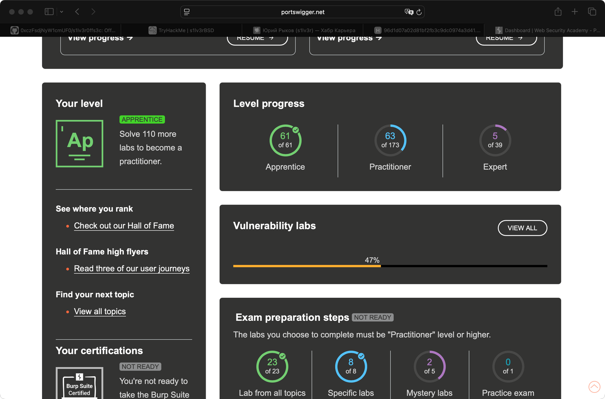
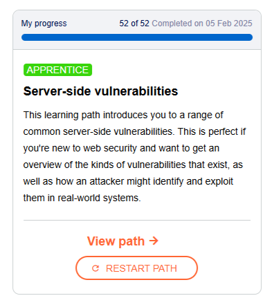
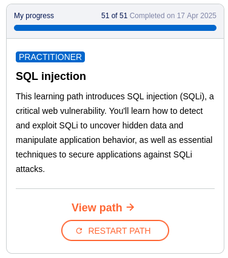
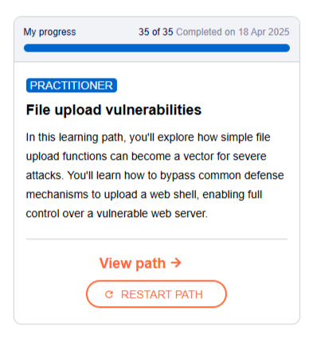
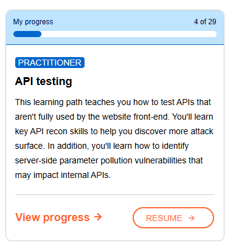
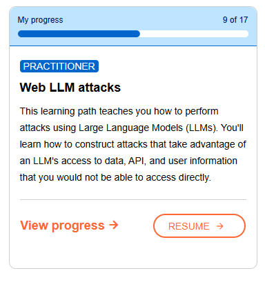

# 0x00 :: PortSwigger Web Security Academy — Progress Log

---

## 0x01 :: Progress Summary

Обновлено 2026-11-05 по live-списку всех лаб (273 шт., сверено с дашбордом): 

|| Category                | Value                        |
||-------------------------|------------------------------|
|| Current Level           | APPRENTICE (до Practitioner ещё 110 лаб) |
|| Labs Completed (Appr.)  | 61 / 61 — закрыт полностью   |
|| Labs Completed (Pract.) | 63 / 173                     |
|| Labs Completed (Expert) | 5 / 39                       |
|| Vulnerability labs      | 47%                          |

---

## 0x02 :: Certification Status

Exam Readiness: **NOT READY** — до экзамена остались только mystery labs и пробный.  
Requirements (Practitioner level labs and up):

|| Segment                  | Progress       |
||--------------------------|----------------|
|| Labs from all topics     | 23 / 23 — DONE |
|| Specific labs            | 8 / 8 — DONE   |
|| Mystery labs             | 2 / 5          |
|| Practice exam            | 0 / 1          |

---

## 0x03 :: Progress по темам

A = Apprentice, P = Practitioner, E = Expert. Формат «решено/всего».

| Тема | A | P | E |
|------|---|---|---|
| API testing | 1/1 | 0/3 | 0/1 |
| Access control vulnerabilities | 9/9 | 1/4 | 0/0 |
| Authentication | 3/3 | 6/9 | **1/2** ✅ |
| Business logic vulnerabilities | 4/4 | 2/7 | 0/1 |
| Clickjacking | 3/3 | 1/2 | 0/0 |
| Cross-origin resource sharing (CORS) | 2/2 | 1/1 | 0/0 |
| Cross-site request forgery (CSRF) | 1/1 | 1/10 | 0/0 |
| Cross-site scripting | 9/9 | 2/16 | 0/5 |
| DOM-based vulnerabilities | 0/0 | 1/5 | 0/2 |
| File upload vulnerabilities | 2/2 | 4/4 | **1/1** ✅ |
| GraphQL API vulnerabilities | 1/1 | 0/4 | 0/0 |
| HTTP Host header attacks | 2/2 | 1/4 | 0/1 |
| HTTP request smuggling | 0/0 | 2/15 | 0/7 |
| Information disclosure | 4/4 | 1/1 | 0/0 |
| Insecure deserialization | 1/1 | 3/6 | 0/3 |
| JWT | 2/2 | 2/4 | 0/2 |
| NoSQL injection | 2/2 | 0/2 | 0/0 |
| OAuth authentication | 1/1 | 2/4 | 0/1 |
| OS command injection | 1/1 | 1/4 | 0/0 |
| Path traversal | 1/1 | 5/5 | 0/0 |
| Prototype pollution | 0/0 | 0/9 | 0/1 |
| Race conditions | 1/1 | 3/4 | **1/1** ✅ |
| SQL injection | 2/2 | 16/16 | 0/0 |
| Server-side request forgery (SSRF) | 2/2 | 2/3 | **2/2** ✅ |
| Server-side template injection | 0/0 | 1/5 | 0/2 |
| Web LLM attacks | 3/3 | 1/4 | 0/1 |
| Web cache deception | 1/1 | 0/3 | 0/1 |
| Web cache poisoning | 0/0 | 1/9 | 0/4 |
| WebSockets | 1/1 | 1/2 | 0/0 |
| XML external entity (XXE) injection | 2/2 | 1/6 | 0/1 |
| Essential skills (learning path) | — | 1/2 | — |

Закрытые темы целиком (все тиры): **SQL injection**, **Path traversal**, **File upload**, **Access control**, **CORS**, **Information disclosure**, **Race conditions**, **SSRF**.

---

## 0x04 :: Expert labs — разборы

Все 5 пройденных экспертных лаб разобраны в [`labs/`](./labs/):

- [Blind SSRF with Shellshock exploitation](./labs/ssrf-blind-shellshock.md) — эксфильтрация имени юзера через DNS
- [SSRF with whitelist-based input filter](./labs/ssrf-whitelist-bypass.md) — рассинхрон двух URL-парсеров через `%2523`
- [2FA bypass using a brute-force attack](./labs/2fa-bruteforce-macro.md) — макрос против logout-защиты
- [Web shell upload via race condition](./labs/file-upload-race-condition.md) — TOCTOU между записью и удалением
- [Partial construction race conditions](./labs/partial-construction-race.md) — регистрация с null-токеном

---

## 0x05 :: Learning paths

|| Module                     | Status       | Screenshot File              |
||----------------------------|--------------|------------------------------|
|| Server-side vulnerabilities| 52 / 52 DONE |        |
|| SQL Injection          | 51 / 51 DONE     |                |
|| File Upload            | 35 / 35 DONE     |         |
|| API Testing            | 1 / 5 лаб        |         |
|| WEB LLM attacks        | 4 / 8 лаб        |         |

---

## 0xFF :: Get Certified?

Цель — BSCP (Burp Suite Certified Practitioner). Уже не как до луны: экзаменационные требования по обычным лабам закрыты, осталось добить симуляцию самого экзамена.

Что мешает:
- Mystery labs — 2/5, это по сути симуляция экзамена
- Practice exam не пробовал вообще

Очередь: mystery labs → practice exam → записываться на BSCP. Practitioner-лабы параллельно копаются сами по мере прохождения тем (сейчас 63/173). Ближайшие кучки по темам: CSRF (1/10), XSS (2/16), HTTP request smuggling (2/15), web cache poisoning (1/9), prototype pollution (0/9).

Промежуточные бейджи по пути: скрины профилей TryHackMe лягут в `Certs/`, как только руки дойдут.

## 0x100 :: Lab Notes

Разборы отдельных лаб, где был неочевидный ход или где ловился сам — в `labs/`:

- [`labs/`](./labs/)
